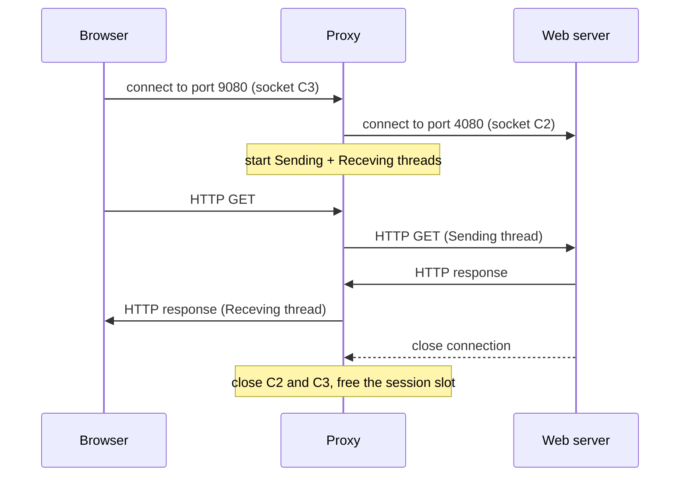

# Multithreaded HTTP Security Proxy

A multithreaded application-layer HTTP proxy for Windows, written in C++ with Winsock 2 and Win32 threads (`_beginthread`). It sits between web browsers and a web server and forwards traffic in both directions. If a browser connects from a blocked IP address, the proxy sends back an `HTTP 403 Forbidden` page instead.
## How it works

### Allowed clients

1. The main thread listens on port 9080 and accepts each browser connection.
2. For every accepted connection, it opens a new socket to the web server on port 4080. It stores both sockets in a session slot. Up to 100 sessions can be open at once.
3. It starts two threads for that session:
   - **`Sending`** (browser → server): receives from the browser and sends to the web server.
   - **`Receving`** (server → browser): receives from the web server and sends to the browser. When the server closes its connection, this thread closes both sockets and frees the slot.
4. The main thread goes straight back to `accept()`. When a browser requests many files at once (images, CSS, and so on), each request gets its own session and pair of threads.

Each `send()` call is repeated until the whole buffer has gone out, so a partial send never drops data.

### Blocked clients

If the browser's IP matches `PROHIBITED_IP`, the proxy does not contact the web server. It starts a single `Forbidden` thread that:

1. Receives the browser's HTTP GET.
2. Reads `HTTP_403.html` from disk.
3. Sends an `HTTP/1.1 403 Forbidden` header followed by the contents of that file.
4. Closes the socket.

## Configuration

All settings are `#define` constants at the top of [proxy_555/proxy_555.cpp](proxy_555/proxy_555.cpp):

| Constant | Default | Meaning |
| --- | --- | --- |
| `PROXY_PORT` | `9080` | Port the proxy listens on for browsers |
| `SERVER_IP` | `"127.0.0.1"` | IP address of the real web server |
| `HTTP_PORT` | `4080` | Port of the real web server |
| `PROHIBITED_IP` | `"0.0.0.0"` | Client IP that receives the 403 page (`0.0.0.0` blocks nobody) |
| `MAX_SES` | `100` | Maximum number of sessions open at the same time |
| `MAX_BUF` | `1200` | Buffer size in bytes for each `recv()`/`send()` |

By default the proxy expects the web server on the same PC and blocks no one. Before building, set `SERVER_IP` to your web server's address, and set `PROHIBITED_IP` to the address of the machine you want to block.

## Requirements

- Windows 10 or 11
- Visual Studio 2026 with the **Desktop development with C++** workload. The project uses the v145 toolset and the `.slnx` solution format.
- The course's test web server, `test_server.cpp`, running on port 4080. It is not included in this repository.

## Build and run

1. Open [proxy_555/proxy_555.slnx](proxy_555/proxy_555.slnx) in Visual Studio.
2. Set the constants listed under [Configuration](#configuration).
3. Choose **x64** and **Debug** (or **Release**), then select **Build → Build Solution**.
4. Start the web server on the machine at `SERVER_IP`.
5. Run the proxy with **F5** or **Ctrl+F5**. It prints `Proxy: listening on port 9080`. If Windows Defender Firewall asks, allow access so that other machines can connect.
6. In a browser, open `http://<proxy-ip>:9080/<file>.html`.

The proxy looks for `HTTP_403.html` in its working directory. Visual Studio starts the program from `proxy_555/`, which already contains the file. If you run the `.exe` directly from `x64\Debug`, copy `http_403.html` into that folder first.

## How to test

| Step | Test | Expected result |
| --- | --- | --- |
| 1 | Open a page directly from the web server on port 4080 | The server works without the proxy |
| 2 | Open a single HTML file with no links through port 9080 | The page loads exactly as it does without the proxy |
| 3 | Open an HTML page that links to other files (images, etc.) through port 9080 | Every file loads, and the console shows several sessions running in parallel |
| 4 | Set `PROHIBITED_IP` to another machine's address, rebuild, and browse through the proxy from that machine | The browser shows the 403 Forbidden page |

## Limitations

- Only one IP address can be blocked. Only IPv4 is supported.
- The web server's address is set at compile time. The proxy does not read the request's `Host` header, so it can only forward to that one server, as the assignment specifies.
- Once `MAX_SES` sessions are open, any new connection is closed straight away.
